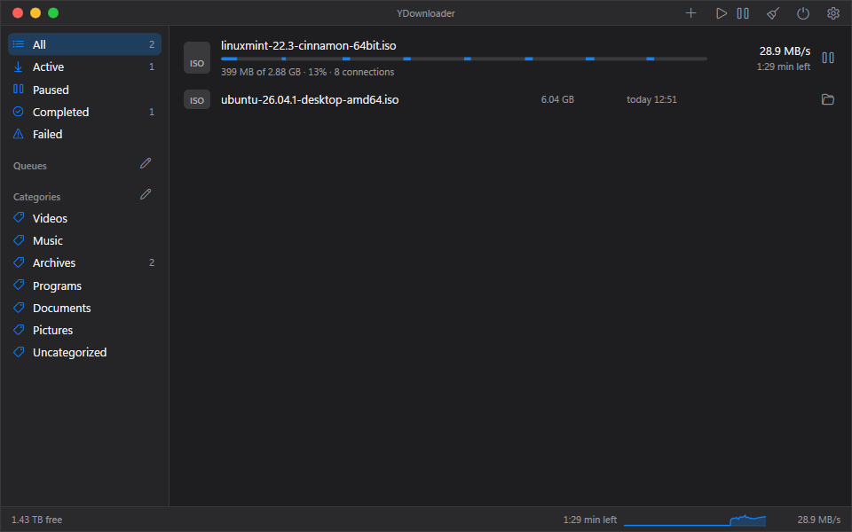
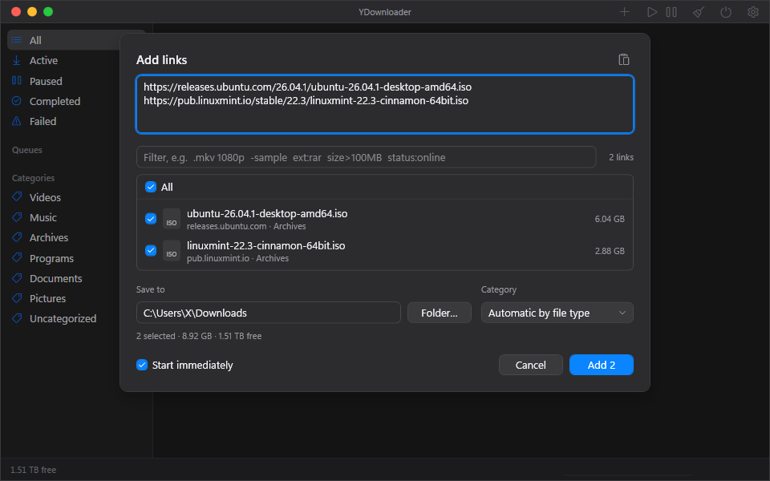

# YDownloader

Schlanker, schneller Download-Manager für Windows 11 (C# .NET 8, WPF).

## Funktionen

- **Downloads:** mehrere Verbindungen je Datei, Fortsetzen, Prüfsummen, Queues mit Zeitplan und eigener Grenze, Limits und
  Verbindungszahl pro Host, „Nach Abschluss“ (Herunterfahren, Ruhezustand, Energie sparen), System wach halten.
- **Linkgrabber und Pakete:** Das Hinzufügen-Fenster erkennt mehrteilige Archive (`.partN.rar`, `.rar` + `.r00`, `.7z.001`,
  `.zip.001`, `.z01`), fasst sie zu Paketen mit eigenem Ordner zusammen und zeigt fehlende Teile. Filter (`ext:`, `size>`,
  `host:`, `status:`), Regeln zum automatischen Abwählen, Online-Check über AllDebrid. In der Hauptliste erscheinen Pakete mit
  einem Kopf (Fortschritt, Tempo, Restzeit).
- **Archive entpacken:** automatisch nach dem Download (abschaltbar) oder per Menü, siehe unten.
- **Archivpasswörter:** Eine Liste in den Einstellungen (verschlüsselt für dein Windows-Konto), ein Passwort per Menü „Passwort
  eingeben …“ und Passwörter, die Click'n'Load mitschickt. YDownloader probiert sie der Reihe nach (höchstens 50) und gibt
  sie 7-Zip über die Standardeingabe, nie über die Kommandozeile. Passt keins, steht „Passwort nötig“ in der Zeile.
- **Zwischenablage-Prüfung** (Standard aus): Auf Wunsch beobachtet YDownloader die Zwischenablage, solange das Fenster nicht
  aktiv ist, und meldet in einem Hinweis nur die Zahl passender Links (Hoster aus der AllDebrid-Liste, Dateien mit bekannter
  Endung, Archivteile). Ein Klick öffnet das Hinzufügen-Fenster, geladen wird erst nach Bestätigung.
- **Click'n'Load** (Standard aus): nimmt Links von Webseiten auf `127.0.0.1:9666` an, auch verschlüsselte (AES) samt
  Passwörtern. Es startet nichts von selbst, die Links landen im Hinzufügen-Fenster.
- **Browser-Erweiterung** für Chrome und Firefox: Rechtsklick auf Link, Bild, Video, Audio oder markierten Text.
- **AllDebrid:** Links unterstützter Hoster werden beim Start entsperrt, alle anderen laden direkt.
- **Oberfläche:** helles und dunkles Design, Skalierung 80–200 %, Tray-Symbol, Autostart, 7 Sprachen (de, en, es, fr, it,
  pt-BR, tr; Windows-Sprache, sonst Englisch).

## Messwerte

Gemessen mit einem Release-Build (ReadyToRun, win-x64) in einer portablen Kopie, leere Liste, je ein Lauf, drei Minuten
Leerlauf, auf einem Rechner (Windows 11, AMD-Grafik). Das Fenster war nach etwa 323 ms sichtbar (framework-dependent).
Der **private Arbeitssatz** (Private Working Set) lag bei etwa 60 bis 64 MB. Das **Working Set** (inklusive geteilter Seiten
wie Grafiktreiber und Runtime) lag bei etwa 130 bis 136 MB. Andere Rechner, Grafiktreiber und Listen geben andere Werte; mit
laufenden Downloads liegt der Verbrauch höher.

## Hinweise

- YDownloader steht in keiner Verbindung zu AllDebrid, JDownloader oder Apple. Die Namen gehören ihren Inhabern und stehen nur
  da, um Kompatibilität zu beschreiben (die Fensterleiste ist nur im Stil von macOS gestaltet).
- Nur für legale Inhalte gedacht: eigene Dateien, frei lizenzierte Werke, Material, für das du die Rechte hast. Was du lädst,
  verantwortest du selbst.
- Die `YDownloader.exe` ist **nicht signiert**. Windows SmartScreen kann beim ersten Start warnen („Der PC wurde durch Windows
  geschützt“): „Weitere Informationen“ → „Trotzdem ausführen“. Prüfe vorher die SHA-256-Summe der Zip-Datei gegen
  `SHA256SUMS.txt` aus dem Release.

## Installation

Es gibt zwei Pakete (mit `tools\publish.ps1` erzeugt, als Zip im Release):

- **framework-dependent** (Zip, ca. 2 MB): braucht die [.NET 8 Desktop Runtime](https://dotnet.microsoft.com/download/dotnet/8.0)
  (x64). Zip in einen Ordner entpacken.
- **self-contained** (Zip, ca. 62 MB): bringt die Runtime mit, nichts weiter nötig. Zip in einen Ordner entpacken.

`YDownloader.exe` starten, es gibt keinen Installer. Daten (Liste, Einstellungen) liegen unter `%AppData%\YDownloader`.

## Portable-Modus

Eine leere Datei namens `.portable` neben die `YDownloader.exe` legen. Dann liegen alle Daten im Programmordner. Im
Einstellungs-Sheet lässt sich das auch umschalten (die Daten werden dabei kopiert, die alten Dateien bleiben liegen).

## Browser-Erweiterung

Rechtsklick auf Link, Bild, Video, Audio oder markierten Text schickt die Links an YDownloader. Im Programm: Einstellungen
(Strg+,) → Dienste → Browser. Dort steht der Pfad zum Ordner `Extension`.

1. **Verbinden** im Browser-Sheet drücken. Das trägt den Native-Messaging-Host für den aktuellen Benutzer in der Registry ein
   (`HKCU`, nur auf diesen Knopf).
2. **Chrome:** `chrome://extensions`, Entwicklermodus an, „Entpackte Erweiterung laden“, den Ordner `Extension` wählen.
3. **Firefox:** `about:debugging` → „Dieser Firefox“ → „Temporäres Add-on laden“ → `Extension\firefox\manifest.json`.
   Firefox behält die Erweiterung so **nur bis zum Schließen**; dauerhaft bräuchte sie eine Signatur.

Ein Klick auf das Symbol der Erweiterung prüft die Verbindung („OK“ am Symbol). Die Links erscheinen im Hinzufügen-Dialog,
geladen wird erst nach Bestätigung. Wird der Programmordner verschoben, im Browser-Sheet „Aktualisieren“ drücken.

## Click'n'Load und Zwischenablage

Beide sind standardmäßig aus und stehen in den Einstellungen (Dienste). Click'n'Load lauscht nur auf dem eigenen Rechner
(`127.0.0.1:9666`); ist der Port belegt (etwa durch JDownloader), meldet YDownloader das. Die Zwischenablage-Prüfung liest nur,
wenn das Fenster nicht aktiv ist, und merkt sich Links nur im Speicher.

## AllDebrid

Einstellungen → Dienste → Debrid: API-Key einfügen, „Prüfen“, „Übernehmen“. Der Key wird nur für dein Windows-Konto
verschlüsselt gespeichert. Links von unterstützten Hostern werden dann beim Start über AllDebrid entsperrt, alle anderen laden
direkt. Im Hinzufügen-Dialog zeigt ein Punkt, ob ein Link online ist.

## Entpacken

Fertige Archive (`.zip`, `.rar`, `.7z`, auch mehrteilige Pakete) werden automatisch entpackt (abschaltbar), auch einzelne
Archive in einen Unterordner mit dem Archivnamen. Einfache ZIP-Dateien gehen ohne Zusatz, alles andere und alles mit Passwort
braucht **7-Zip** (empfohlen, wird in `Program Files` und im PATH gefunden, sonst Pfad in den Einstellungen angeben). Ersatzweise
entpackt `tar.exe` von Windows einteilige RAR und 7z (ohne Passwort). Archive werden nie gelöscht, vorhandene Dateien nie
überschrieben, unsichere Pfade im Archiv werden abgelehnt. Archivpasswörter siehe oben.

## Bekannte Grenzen

- RAR wurde bisher nicht mit echten Archiven getestet.
- Keine Cookies und kein Referer für Downloads: Was hinter einem Login liegt, geht so nicht.
- Keine DLC-Unterstützung.
- Passwörter von Archiven liegen kurz im Speicher von YDownloader und 7-Zip.
- AllDebrid ist nur nach der Dokumentation umgesetzt, nicht gegen den echten Dienst gelaufen. Die englischen und übersetzten
  Texte hat kein Muttersprachler gelesen.

---

# English

YDownloader is a lean, fast download manager for Windows 11 (C# .NET 8, WPF).

**Features.** Multi-connection downloads with resume and checksums; queues with schedules and limits; per-host limits;
"after completion" actions (shut down, hibernate, sleep); keep-awake. The Add dialog is a link grabber: it detects multi-part
archives (`.partN.rar`, `.rar` + `.r00`, `.7z.001`, `.zip.001`, `.z01`), groups them into packages with their own folder, shows
missing parts, and offers filters (`ext:`, `size>`, `host:`, `status:`), auto-deselect rules and an online check via AllDebrid.
Light and dark theme, UI scaling 80–200 %, tray icon, autostart, and 7 languages (de, en, es, fr, it, pt-BR, tr; the Windows
language, English otherwise).

**Archive passwords.** A list in Settings (encrypted for your Windows account), a password entered from the row menu
("Enter password …"), and passwords sent along by Click'n'Load. They are tried in turn (at most 50) and handed to 7-Zip through
standard input, never on the command line. If none fits, the row says "Password needed".

**Clipboard check** (off by default). While the window is not active, YDownloader can watch the clipboard and show a notice with
only the number of matching links (hosts from the AllDebrid list, files with a known extension, archive parts). Clicking it opens
the Add dialog; nothing downloads until you confirm.

**Click'n'Load** (off by default). Accepts links from web pages on `127.0.0.1:9666`, including encrypted (AES) ones with their
passwords. Nothing starts by itself; the links appear in the Add dialog. If the port is taken (e.g. by JDownloader), YDownloader
says so.

**Measurements.** Release build (ReadyToRun, win-x64), portable copy, empty list, one run each, three minutes idle, on one machine
(Windows 11, AMD graphics). The window was visible after about 323 ms (framework-dependent). The **private working set** was about
60–64 MB; the **working set** (including shared pages such as the graphics driver and runtime) about 130–136 MB. Other machines,
drivers and lists will differ, and running downloads use more.

**Notes.** Not affiliated with AllDebrid, JDownloader or Apple; names are used only to describe compatibility. Intended for
legal content only; you are responsible for what you download. `YDownloader.exe` is **not code-signed**, so Windows SmartScreen
may warn on first start ("More info" → "Run anyway"). Compare the zip's SHA-256 with `SHA256SUMS.txt` from the release.

**Install.** Two packages: *framework-dependent* (zip, about 2 MB, needs the
[.NET 8 Desktop Runtime](https://dotnet.microsoft.com/download/dotnet/8.0), x64) and *self-contained* (zip, about 62 MB,
nothing else needed). There is no installer: run `YDownloader.exe`. Data lives in `%AppData%\YDownloader`.

**Portable mode.** Create an empty file named `.portable` next to `YDownloader.exe`; all data then stays in the program folder.

**Browser extension.** Right-click a link, image, video, audio or selected text. Settings (Ctrl+,) → Services → Browser, press
*Connect* (writes the native messaging host under `HKCU`, only on that button). Chrome: `chrome://extensions`, developer mode,
*Load unpacked*, choose the `Extension` folder. Firefox: `about:debugging` → *This Firefox* → *Load Temporary Add-on* →
`Extension\firefox\manifest.json`; Firefox keeps it **only until it closes** (permanent install would need a signature). Links go
to the Add dialog and nothing starts until you confirm.

**AllDebrid.** Settings → Services → Debrid: paste the API key, *Check*, *Apply*. The key is stored encrypted for your Windows
account only. Links from supported hosts are unlocked at start, everything else downloads directly.

**Extracting.** Finished `.zip`, `.rar` and `.7z` archives (also multi-part, and single archives into a subfolder named after the
archive) are extracted automatically (can be turned off). Plain ZIP works out of the box; everything else and anything with a
password needs **7-Zip** (recommended; set its path in Settings if it is not found). `tar.exe` is a fallback for single-part RAR
and 7z without a password. Archives are never deleted, existing files never overwritten, unsafe paths in an archive are rejected.

**Known limits.** RAR is untested with real archives. No cookies or referer for downloads behind a login. No DLC support.
Archive passwords are briefly held in memory by YDownloader and 7-Zip. AllDebrid follows the documentation and has never run
against the real service. Translations have not been read by native speakers.
